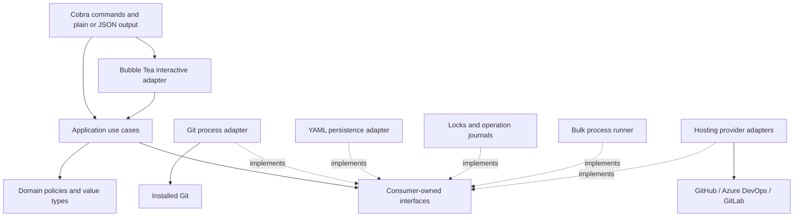

# ADR-0001: Bearforge architecture and implementation blueprint

Status: Proposed for implementation

Date: 2026-11-10

Audience: the project maintainer, contributors, and adopting teams

## 1. Decision and scope

Build Bearforge as a local Go CLI that orchestrates the installed Git executable. Keep one managed bare repository per registered repository identity and create ordinary linked Git worktrees inside named workspace directories. Use Cobra for commands, Charmbracelet Bubble Tea for interactive terminal experiences, versioned YAML for declarative intent, and local JSON operation journals for recovery. Bubble Tea is an explicit maintainer preference.

Use a small hexagonal architecture: command adapters call application services; services express workspace rules and depend on narrow interfaces; Git, files, processes, and hosting providers implement those interfaces. Ship one executable, with no daemon, database server, or required hosting-provider CLI.

The first supported deployment is one developer, one machine, and one local installation root. Team members share repository catalogs, not bare repositories or mutable worktree directories over network storage. Hundreds of repositories do not require a distributed system.

These are design recommendations, not an assertion that an implementation already exists. Code below defines representative contracts and skeletons; it is not a finished CLI.

### Goals

- Manage 50–500 repositories and dozens of workspaces without duplicating Git object databases for each workspace.
- Make small feature workspaces cheap to create and inspect.
- Keep all repositories usable with ordinary Git and existing IDEs.
- Preserve local edits and commits during failures, cancellation, and cleanup.
- Provide predictable automation, useful errors, and a maintainable open-source codebase.

### Scope clarifications

A workspace contains **zero or more** worktrees. Zero enables incremental creation; one or two is a common case, not a limit. A `main` workspace can contain all 50 repositories.

“Store once” means one managed object database per repository identity within an installation. Checkout files, build artifacts, dependency caches, submodules, and Git LFS objects may still consume additional storage. This is not cross-repository object deduplication. Do not configure Git object alternates.

V1 does not provide automatic pull/rebase, pushing, PR creation, cross-repository atomic commits, background synchronization, remote workspace hosting, arbitrary plugin execution, or a build dependency scheduler. PR lookup is read-only. Submodule-heavy repositories are outside the initial support contract because linked-worktree submodule support has limitations; detect and report them before provisioning. [Git worktree documentation](https://git-scm.com/docs/git-worktree)

## 2. Architectural decisions and alternatives

| Decision | Recommendation | Rationale and consequence |
|---|---|---|
| Language | Go | Single native executable, practical cross-compilation, straightforward subprocesses and concurrency, small operational footprint. |
| CLI | Cobra | Nested commands, flags, help and shell completion fit this command surface. Keep Cobra out of the core. |
| Interactive terminal UI | Bubble Tea v2, with Bubbles and Lip Gloss | Stateful views, reusable components and terminal styling; shares application services with CLI commands. Keep all Charm types in presentation adapters. |
| Git integration | Installed `git` executable | Preserves Git authentication and semantics; avoids recreating worktree behavior with a library. |
| Configuration | YAML documents | Readable repository maps and workspace definitions; suitable for review and version control. Requires strict parsing. |
| Operational state | Local JSON journals and advisory locks | Recovery and ownership evidence without making a second Git database. |
| Consistency | Preflight, journal, apply, verify, commit metadata | Git operations and file replacement cannot form one ACID transaction. Partial outcomes must be visible. |
| Parallelism | Bounded worker pool across repositories | Useful throughput without unbounded Git, SSH, or build processes. |
| Packaging | One Go module, internal packages | Avoid separate services and premature public APIs. |

Rust with Clap is a credible alternative if it is the maintainer's strongest language; its additional implementation effort offers little advantage for an application dominated by Git subprocesses. Python is effective for a prototype but adds runtime/distribution concerns for teammates. TypeScript similarly brings a runtime or executable packaging layer. Choose Go unless personal expertise strongly favors another option.

TOML is a reasonable alternative for preferences, but YAML is easier to scan for nested repository and workspace maps. SQLite gives stronger transactions within its own database but cannot atomically commit Git operations, and binary files make team review harder. Avoid SQLite initially. A future disposable SQLite cache may index PR results or large status histories; it must never become authoritative for Git state.

Use the current patched supported Go release for builds and test the newest two supported Go release families. Freeze an explicit toolchain in CI when implementation starts. The official release policy supports each major release until two newer majors exist. [Go release policy](https://go.dev/doc/devel/release#policy)

## 3. Authority model

“Git is the source of truth” applies to Git facts. Git does not have a native concept of Bearforge workspace membership, so that requires separate intent.

| Information | Authority | Bearforge behavior |
|---|---|---|
| Refs, commits, current branch, upstream, remotes | Git commands | Inspect when needed; never trust a cached copy for a mutation. |
| Worktree registration and common repository | Git commands | Discover and verify; include unmanaged worktrees when checking conflicts. |
| Modified, untracked, ignored files | Git plus filesystem | Inspect live before removal. |
| Workspace membership, intended branch | YAML | Desired organization, not proof of checkout state. |
| Intended remote URL and provider identity | YAML | Bootstrap and validation input; actual configured remote is read from Git. |
| Interrupted operation | Local journal plus fresh observations | Journal records intent and provenance; observation determines what actually happened. |
| PR state | Hosting provider | Cache only with timestamp and explicit freshness. |

If someone runs `git switch hotfix` in a worktree intended for `feature-123`, `workspace show` displays both. `status` reports drift. Bearforge does not switch it back, reset it, or silently rewrite the manifest. An explicit `workspace reconcile NAME --adopt` updates intent after preview and validation. A remote URL changed through Git is likewise reported as drift; mutation requires an explicit `repo reconcile NAME --adopt` or `--restore` choice.

Deleting a cache must be harmless. Losing intent can be partially recovered by discovering Git worktrees, but the user's logical groupings cannot be perfectly reconstructed. Losing journals must not trigger automatic deletion of unexplained directories.

## 4. High-level architecture



Dependencies point inward. The domain imports the standard library only. Application services know no Cobra, Bubble Tea, Bubbles, Lip Gloss, YAML decoder, OS-specific locking implementation, or provider SDK. Adapters may depend on domain and application contracts. `cmd/bearforge/main.go` is the composition root.

The Elm Architecture applies inside the terminal adapter: the model holds presentation state, update handles messages, and view describes rendering. It does not replace the domain model, application workflows or durable recovery journal. [Elm architecture](https://guide.elm-lang.org/architecture/)

Avoid an interface for every struct. Create ports where side effects, policy boundaries, or meaningful test doubles justify them. No generic CRUD repository framework, dependency injection framework, event bus, or service locator.

## 5. Domain model and aggregate boundaries

| Concept | Identity and data | Invariants |
|---|---|---|
| Repository | Portable repository ID; desired remotes; default base; optional provider coordinates | Exactly one active managed bare location per ID; no conflicting canonical remote identity. |
| Workspace | Portable workspace ID; default branch policy; membership map | At most one worktree of each repository; deterministic workspace path. |
| Branch mapping | Workspace/repository pair; branch; initial base; tracking policy; PR target | Branch is a Git-valid branch name; creation base is not automatically an upstream. |
| Worktree observation | Repository; absolute path; actual ref/OID; lock/prunable state | Derived from Git, not independently saved as authoritative state. |
| Operation | Random ID; steps; preconditions; results; metadata revision | Durable intent precedes every side effect; completed steps are verified before reuse. |

Repository is the aggregate for remote configuration and repository-level mutation policy. Workspace is the aggregate for membership and mappings. A branch mapping belongs to its workspace, not a global “branch mapping service.”

A worktree spans a workspace and repository. Cross-aggregate provisioning is an application workflow with a recovery journal, not a transaction hidden inside either aggregate. Git enforces its own ref/worktree rules. Removing a repository must check both all manifests and every Git-registered linked worktree, including ones outside Bearforge.

Do not model the whole installation as an in-memory aggregate that reads every Git repository on startup. A catalog lists identities; services load only the workspace and repositories needed by a command.

Repository identity detection is conservative. Normalize supported provider coordinates when available, including SSH/HTTPS aliases for the same host/project. For unknown hosts, compare normalized URLs conservatively and require explicit identity overrides for aliases. Never collapse distinct paths merely because their final repository names match.

## 6. Filesystem and configuration

The installation root defaults to `~/code`. Resolve the home directory through the OS, not literal shell tilde expansion. Support `--root`, then `BEARFORGE_ROOT`, then a local preferences default, in that order. Explicit root selection wins over current-directory discovery. Discovery walks ancestors for `.bearforge/catalog.yaml`; otherwise use the configured default.

```text
~/code/
  .bearforge/
    catalog.yaml                 # shareable repository catalog and root defaults
    workspaces/
      main.yaml                  # one intent document per workspace
      feature-123.yaml
    state/                       # local only; never committed or cloud-synced
      mutation.lock
      operations/<operation-id>.json
      cache/prs/...
    trash/<operation-id>/repo1.git  # explicit repo retirement; no automatic purge
  repos/
    repo1.git/
    repo2.git/
  main/
    repo1/                       # Git-managed linked worktree
    repo2/
  feature-123/
    repo1/
```

Version-control `.bearforge` intent files in a separate configuration repository if desired; ignore `state/`, `trash/`, temporary files and local preferences. Never add bare repository directories or worktree contents to that configuration repository. Per-user preferences and credentials remain outside shareable intent, using the platform's configuration directory. Do not automatically commit or synchronize configuration changes.

V1 derives all paths: `<root>/repos/<repo-id>.git` and `<root>/<workspace-id>/<repo-id>`. IDs use a documented portable lowercase subset such as `[a-z0-9][a-z0-9._-]*`, with a 64-character limit. Reject `.`/`..`, trailing dots, Windows reserved device names, reserved root names such as `repos`, and case-insensitive collisions. Reject separators and paths supplied as names. Branch names are separate: `feature/payments-123` can map to workspace `payments-123`.

Canonicalize the existing parent, validate containment, and inspect symlinks/junctions before operations. Never follow an unexpected link to delete a directory. For v1, refuse mutation through reparse points/symlinks within managed storage and workspace paths. Preflight full path lengths on Windows and return actionable errors; do not change machine-wide long-path settings. Local disks are the supported storage target; network shares and live cloud-synced mutable state are unsupported.

### Catalog example

```yaml
schema_version: 1
defaults:
  remote: origin
  jobs: 4
repositories:
  repo1:
    remotes:
      origin: git@github.com:company/repo1.git
    base: refs/remotes/origin/main
    provider:
      kind: github
      host: github.com
      repository: company/repo1
  repo2:
    remotes:
      origin: git@github.com:company/repo2.git
    base: refs/remotes/origin/develop
extensions: {}
```

### Workspace example

```yaml
schema_version: 1
name: feature-123
default_branch: feature-123
repositories:
  repo1:
    branch: feature-123
    base: refs/remotes/origin/main
    tracking: none
    pr_target: main
  repo2:
    branch: team/feature-123
    base: refs/remotes/origin/develop
    tracking: none
    pr_target: develop
extensions: {}
```

`base` is the creation policy, not a promise that a moving remote ref still has the original OID. Record the resolved starting OID in the operation journal. `tracking` is `none`, `same-name`, or `preserve`; existing branches default to `preserve`. If `same-name` is requested, require the corresponding remote ref to exist or return a precise error. Never invent an upstream.

Select repositories explicitly through repeatable `workspace create --repo` flags, `workspace add`, or the interactive repository selector. `--all` explicitly selects the entire catalog. For new mappings, precedence is explicit per-repository CLI override, explicit workspace-wide CLI flag, repository default, then discovered remote default. Existing mappings are preserved unless a specific update is requested.

### Validation and persistence rules

- Parse only one YAML document. Reject duplicate keys, unknown fields outside `extensions`, merge keys, aliases, unsupported tags, excessive nesting, and oversized files.
- Decode to typed structures and run domain validation. Publish a JSON Schema for editor support; the CLI's semantic validation also checks cross-document repository references and Git-valid branches.
- No environment expansion, executable expressions, hooks, or credentials in shareable YAML. Credential-bearing remote URLs are rejected; users configure Git credential helpers or SSH normally.
- Preserve comments using YAML nodes when updating documents. Produce deterministic ordering and small diffs. If a safe edit cannot be represented, fail without rewriting the file.
- Save via a temporary sibling file, flush, atomically replace the destination with platform-specific support, and flush the parent where supported. On Windows use a tested replace implementation; do not assume Unix rename-overwrite behavior.
- Compare the source content digest before replacement. Bearforge's lock protects other Bearforge processes, not arbitrary editors; detected edits cause a conflict and replan. Document that manual concurrent editing during mutations is unsupported.
- A multi-file change has a journaled commit sequence and recoverable revision checks. Never call several file replacements a transaction.

## 7. Git repository initialization and branch semantics

### Bare clone initialization

A bare clone copies branch heads but does not create the normal remote-tracking branch layout. Bearforge must configure that layout explicitly before using `origin/main`. Do not use `--mirror`, which has different ref overwrite semantics. [Git clone documentation](https://git-scm.com/docs/git-clone.html)

Conceptual commands for a new repository, with arguments passed separately:

```sh
git clone --bare -- <remote-url> <root>/repos/<repo>.git
git -C <bare> config --local remote.origin.fetch '+refs/heads/*:refs/remotes/origin/*'
git -C <bare> config --local core.logAllRefUpdates true
git -C <bare> config --local push.default simple
git -C <bare> fetch --all --prune
git -C <bare> remote set-head origin -a
```

Journal the destination reservation before clone. Clone into the final reserved path so interruption does not create a hidden second database to adopt accidentally. Only the operation owning that reservation may resume it. An existing unexplained directory is a conflict, even if it appears empty or contains a repository.

Configure the fetch destination only under `refs/remotes/<remote>/`; reject mirror settings or mappings that write fetched heads into `refs/heads/*`. Each managed remote receives its own namespace. The leading `+` permits tracking remote rewrites, not rewriting local branches. Sync performs fetch/prune without merging or resetting checkouts. Inspect effective configuration, including user overrides, before mutation. [Git fetch documentation](https://git-scm.com/docs/git-fetch)

Also reject effective `fetch.pruneTags=true` or `remote.<name>.pruneTags=true`, tag refspecs, and any prune destination outside that remote's tracking namespace. Ordinary fetch may acquire tags, but Bearforge sync must not prune local tags. Explain the conflicting setting and require an explicit configuration correction; never silently rewrite global configuration. Include configuration inherited from global files and conditional includes in this check.

Bare cloning creates local branch heads too. Keep them; do not delete or reset them as initialization cleanup. Fetch will update tracking refs, not automatically advance those local branches. Therefore a pre-existing `main` may lag `origin/main`; show that fact rather than silently moving it.

Before publishing a newly cloned registration, initialize upstreams for the copied local branches that have matching origin tracking refs, using journaled `git branch --set-upstream-to=origin/<branch> <branch>` calls. This makes a later `main` workspace usable with ordinary pull/status without resetting commits. This initialization applies only to branches proven to belong to that fresh clone operation; adopted repositories and later-created feature branches retain their own tracking policy.

Remote-default discovery uses `git ls-remote --symref <remote> HEAD` and, after fetch, `git remote set-head <remote> -a`. An explicit repository base wins. If there is no advertised default or the repository is empty, registration can succeed with “base unresolved”; normal provisioning requires an existing commit or an explicit later-supported orphan mode. Never assume every repository uses `main`. [Git remote documentation](https://git-scm.com/docs/git-remote)

For newly cloned repositories only, enable reflogs through `git config` to improve recovery. Do not promise reflogs are backups. Keep shared `core.bare=true` and do not set shared `core.worktree`. Avoid enabling `extensions.worktreeConfig` in v1; if later needed, design and test its configuration migration first.

### Branch selection algorithm

Resolve the desired branch from the repository override, workspace default, or workspace ID. Validate with `git check-ref-format --branch`, additionally rejecting option-like values and shorthand such as `@{-1}` so names have literal meaning.

1. If the destination is already the expected registered worktree, with the expected common repository and branch, return success without changing it.
2. If the destination is occupied by anything else, stop. A dirty worktree on another branch is never “fixed” implicitly.
3. Inspect all registered worktrees. If this branch is checked out elsewhere, report that path; require another branch name or explicitly requested detached mode. Never bypass this with Git's force option.
4. If the local branch exists and is available, attach it unchanged, preserving tracking. An explicit incompatible base does not reset it; report that the base only applies to new branches.
5. If only the selected remote has a same-name branch, create a local branch from that remote ref. Default its upstream to that branch unless an explicit tracking policy says otherwise.
6. Otherwise resolve the configured base to a commit OID, create the branch with `--no-track`, and attach the worktree. A base such as `origin/main` does not become the feature branch's upstream.

```sh
# A genuinely new feature, based on a validated commit OID:
git -C <bare> worktree add --no-track -b feature-123 -- <path> <base-oid>

# Attach an existing branch without moving it:
git -C <bare> worktree add -- <path> feature-123

# Existing remote feature; creation and tracking are separately journaled:
git -C <bare> worktree add --no-track -b feature-123 -- <path> <remote-feature-oid>
git -C <bare> branch --set-upstream-to=origin/feature-123 feature-123
```

Explicit `--base` with no explicit tracking policy selects creation from that base and `none`, overriding same-name remote discovery. Explicit `--track=same-name` must resolve to a compatible remote branch; conflicting inputs fail during planning. Never use `-B` to reset an existing branch. Git supports explicit branch creation and upstream selection; Bearforge adds the selection policy. [Git branch documentation](https://git-scm.com/docs/git-branch)

Expose `--track=none|same-name|preserve`; omitted policy is resolved during planning using this table:

| Branch state | Omitted tracking | Explicit `none` | Explicit `same-name` | Explicit `preserve` |
|---|---|---|---|---|
| Existing local branch | Preserve current upstream | Require no upstream; otherwise conflict | Require the selected same-name upstream already set; otherwise conflict | Preserve current upstream |
| New local branch from same-name remote | Set that remote branch as upstream | Create without upstream | Set that remote branch as upstream | Invalid for a new branch |
| New branch from base | No upstream | No upstream | Require a same-name remote and a matching starting OID; otherwise conflict | Invalid for a new branch |

V1 does not change an existing local branch's upstream through workspace provisioning. A conflict gives the exact `git branch --set-upstream-to` or `--unset-upstream` action the user can intentionally perform, then retry. After creation, persist the resolved policy; later live tracking drift is displayed, never silently repaired. This also applies to an already materialized worktree: no-op requires matching requested policy, not merely a matching path.

A branch can be shared across different repositories, but not normally checked out in two worktrees of the same repository. A workspace name is therefore a default branch choice, not a globally available checkout token.

For attachment, pass the validated **short branch name**, after checking the exact `refs/heads/<name>` exists. Passing `refs/heads/<name>` as the worktree command's commit-ish can produce detached HEAD. Always verify the resulting symbolic HEAD equals the intended full branch ref; never infer attachment merely from exit code zero. Reject ambiguous branch/tag inputs rather than allowing a wrong checkout.

## 8. Command contract

All commands accept `--root`, `--verbose`, `--quiet`, `--color=auto|always|never`, `--output=human|json|jsonl`, and `--no-input`. `--json` aliases `--output=json`. Reject verbose/quiet conflicts. Mutations accept `--dry-run`; destructive commands also accept `--yes`. `--yes` skips a confirmation, never a safety check. Provide `-j/--jobs` only where parallel work exists. Commands with live progress also accept `--ui=auto|plain|inline`; the separate `tui` command opens the full-window interface.

### Repository commands

| Command | Behavior |
|---|---|
| `repo add NAME URL` | Validate identity; reserve path; clone/configure/fetch; verify bare repository; commit catalog entry. Exact existing registration is a no-op. Different URL requires explicit reconciliation. |
| `repo list` | List catalog entries without spawning Git by default. `--live` checks existence and drift. |
| `repo inspect NAME` | Show live remotes, default refs, registered worktrees, intended settings and drift. |
| `repo sync [NAME...]` | Fetch selected repositories; omitted selection means all. Same service as top-level `sync`. |
| `repo remove NAME` | Require no workspace references or linked worktrees; retire the bare directory as an opaque whole into local trash and unregister. Preserve all commits. No automatic purge in v1. |
| `repo restore NAME --operation ID` | Restore a retired repository after checking path and identity conflicts; no new clone. |
| `repo reconcile NAME --adopt\|--restore` | Preview and explicitly resolve catalog/actual remote drift. |

Retirement is a directory lifecycle operation, not editing Git's internal files. Never enumerate or alter internal refs/objects yourself. The rename is same-volume and journaled. If sharing violations prevent it, leave the registration intact. Re-registering a known retired identity offers restoration instead of silently cloning a second copy.

### Workspace commands

| Command | Behavior |
|---|---|
| `workspace init main` | Idempotent convenience for creating an empty workspace definition and directory. Does not implicitly add all repositories. |
| `workspace create NAME` | Same empty creation behavior; supports `--branch`, `--base`, and repeatable `--repo`. |
| `workspace create main --all` | Explicitly materialize the entire catalog. Conflicting selectors fail before mutation. |
| `workspace add NAME REPO...` | Provision selected worktrees; preserve existing matching mappings. |
| `workspace remove-repo NAME REPO...` | Safely remove selected worktrees, then their mappings; preserve branches. |
| `workspace remove NAME` | Preflight every member; remove worktrees safely; delete intent only after success; remove workspace directory only if empty. |
| `workspace list` | List intent, membership counts, and interrupted-operation indicators without a full Git scan. |
| `workspace show NAME` | Compare intended and actual membership, paths, branches and upstreams. |
| `workspace ls NAME` | Compact actual repository/branch listing, with explicit missing/drift markers. |
| `workspace path NAME` | Print only the absolute workspace path; usable by shell integration. |
| `workspace reconcile NAME --adopt` | Adopt verified actual branch mappings; preview changes first. Never import an unrelated repository automatically. |

Branch overrides are unambiguous:

```sh
bearforge workspace add feature-123 repo1 repo3
bearforge workspace add feature-123 repo3 --branch team/feature-123 --base origin/develop
bearforge workspace create audit-feature --repo repo1 --repo repo3
bearforge workspace add audit-feature repo1 repo3 --branch-map repo3=team/audit
```

`--branch` applies to the selected repositories; `--branch-map REPO=BRANCH` overrides it. Persist fully resolved mappings. A repeated command succeeds only if its requested state matches; conflicting settings return a conflict, not a silent no-op.

The CLI cannot change the parent shell's current directory. `workspace path` supports `cd "$(bearforge workspace path feature-123)"` in compatible shells; publish equivalent PowerShell and Fish helpers later. Do not claim that a subprocess can implement shell-wide `cd` by itself.

### Administration

Add `doctor [WORKSPACE]`, `operations list`, `operations show ID`, `operations resume ID`, `config validate`, `config migrate`, `version`, and `completion`. `doctor` is read-only by default; repair actions require an explicit plan and use Git's supported commands. Do not run automatic pruning on startup.

### Interactive command entry points

```sh
bearforge tui                         # Browse workspaces, repositories and health.
bearforge tui feature-123             # Open a specific workspace.
bearforge sync --ui=inline            # Live progress, then a durable summary.
bearforge sync --ui=plain             # Conventional progress lines.
bearforge status feature-123 --json   # Machine-readable output, no terminal UI.
```

Calling `bearforge` without arguments continues to print help. Interactive views are an additional way to invoke the same use cases; no operation is available exclusively through the TUI. Initial dashboard actions are filtering/selecting workspaces and repositories, inspecting status, provisioning explicitly selected repositories, and reviewing concrete removal plans. PR panes arrive with provider support. Refreshes are local by default; fetching remains an explicit action.

## 9. Deletion, interruption, and concurrency

### Safe worktree removal

Removal is the highest-risk operation and must ship with the first usable release, not as later hardening.

1. Resolve and validate every destination and its common repository through Git; reject unexpected links, unmanaged occupants, and ownership mismatch.
2. Inspect tracked modifications, conflicts, untracked files, and ignored content. Ignored build output can still contain valuable files: default deletion refuses ignored content too. Present a summary without exposing file contents. Before relying on status, inspect `git ls-files -v -z` for assume-unchanged or skip-worktree entries and inspect sparse-checkout configuration. V1 refuses removal when these are present, even with `--discard-changes`, because normal status may hide tracked-file edits. Give instructions to resolve the flags or handle that worktree manually, then rerun. [Git ls-files documentation](https://git-scm.com/docs/git-ls-files)
3. Refuse locked worktrees and unsupported initialized submodules. Do not silently unlock or use double-force removal.
4. Preserve branches regardless of ahead/behind. For detached HEAD, create a uniquely named `bearforge/recovery/<operation-id>/<repo>/head` branch at the observed commit through Git before removal. Also enumerate the worktree's surviving HEAD reflog through Git: anchor unique commit tips that are not reachable from retained shared refs under `bearforge/recovery/<operation-id>/<repo>/reflog-<n>`. Journal and verify every created branch before removal; inspection or anchoring failure aborts removal. Already-expired/unavailable reflog history cannot be recovered, and raw reflog messages are not preserved.
5. Obtain confirmation for the concrete list, then recheck immediately before each removal. Noninteractive use requires `--yes`.
6. Use `git worktree remove -- <path>`. Never recursively delete a checkout as a fallback. Git's refusal is authoritative.
7. Commit membership changes after verifying removal. Remove only an empty workspace container; report retained unrelated files without deleting them.

An explicit `--discard-changes` may enable a single Git force removal of dirty/untracked content after a second detailed confirmation; noninteractive use requires both `--discard-changes` and `--yes`. It does not bypass path identity, locks, detached-commit preservation, or submodule checks. Label exactly what will be discarded. Ship this escape hatch only once tested; omitting it from the first release is preferable to unsafe deletion.

Use Git to list ignored content (for example `ls-files --others --ignored --exclude-standard -z`) and inspect reflog/recovery needs; never infer cleanliness solely from a human status string. A clean worktree can still contain unpublished commits. Worktree removal retains its branch, and repository retirement retains the entire database, so neither depends on assuming that “clean” means “backed up.”

Bare directories contain committed history but are still local data. V1 has no automatic trash expiration. A future purge command needs a separate ADR covering confirmation, external backup verification and recovery expectations.

### Operation protocol

```text
load intent -> observe -> construct plan -> show/confirm
  -> acquire mutation lock -> revalidate plan and revisions
  -> persist operation intent
  -> for each step: persist started -> execute -> probe -> persist result
  -> commit metadata -> verify -> complete
```

Each step records operation ID, kind, repository, destination, expected branch/OID, preexisting state, ownership evidence, attempt number, and sanitized failure. States include `planned`, `started`, `succeeded`, `failed`, `needs_attention`; operation states include `running`, `partial`, `complete`, and `cancelled`.

Persist a step's intent before executing it. A crash after Git succeeds but before the success record is the central recovery case: resume probes the actual repository, worktree path, branch and common directory. It does not blindly repeat a clone or erase the path. If a branch exists but checkout creation failed, resume may attach that branch only when provenance and OID still match. If something changed externally, stop for an explicit decision.

Successful worktrees are retained after another repository fails. Apply only verified successful membership deltas and leave the operation visibly partial. Retry plans only missing work. Removal follows the same principle: never recreate a removed checkout automatically to imitate rollback. There is no cross-repository atomicity guarantee.

Interrupted metadata replacement is recovered using old/new document digests and the step journal. Partial clone destinations are preserved for inspection; a later explicit cleanup may retire them, never guess ownership from a directory name alone. On startup, list commands can indicate unfinished operations without automatically running them. Before a conflicting mutation, require resume or explicit abandonment. Abandonment preserves effects and records reconciliation requirements.

### Locking and limits

For v1, use one OS-backed exclusive mutation lock per root. Hold it during structural changes, fetch, migrations, recovery, and bulk `exec`. Operations inside that command can still run concurrently across different repositories. This intentionally serializes separate Bearforge mutation invocations to keep the first implementation auditable. Read-only commands remain available and report observations as snapshots.

Use nonblocking acquisition with a bounded `--lock-timeout`. Store owner diagnostics separately; process IDs and stale file age do not establish ownership. OS locks release on process exit; never delete a locked file to “break” the lock. Git continues to use its own locks. No lock file is placed inside Git metadata by Bearforge.

Default to four fetch workers and one command per repository. Set Git's nested fetch parallelism to one for predictable aggregate limits. Default bulk execution to one worker because build commands can consume many cores; `--jobs` opts into parallel builds. Stop scheduling on cancellation, terminate child process trees, drain output, wait for exit, and persist partial results before releasing the lock.

Git and editors invoked outside Bearforge do not honor this lock. Re-observe immediately before destructive steps, allow Git to reject conflicting operations, and make failure conservative. Do not claim race-free safety against a user editing the same path concurrently. Finer workspace/repository locks are a later measured optimization requiring a documented acquisition order and recovery changes.

`--dry-run` performs read-only observation and prints resolved actions/preconditions. It creates no directories, journals, refs or metadata, and does not fetch or execute user commands. Remote-dependent information may remain unknown; label it. Execution always revalidates and cannot assume an earlier plan is still valid.

## 10. Synchronization, status, execution, and PRs

### Synchronization

`bearforge sync --jobs 4` and `repo sync` share one use case. Select unique registered repositories, inspect fetch configuration, then run the equivalent of `git fetch --all --prune` for each. Continue independent repositories after failure and print counts plus per-repository outcomes. No pull, merge, branch deletion, or checkout update is implied.

Report queued/running/completed/error states, elapsed time and last successful fetch. Authentication failures remain repository-specific. Use finite configurable command timeouts and bounded retries for identifiable transient transport failures; never retry a destructive step just because its exit status is nonzero. Respect user Git configuration except where the managed refspec invariant or bounded concurrency requires an explicit conflict or invocation option.

### Health and status

For each present worktree, parse `git --no-optional-locks -C <path> status --porcelain=v2 -z --branch --untracked-files=normal`. Report staged, unstaged, conflicted and untracked entries separately; recognize detached/unborn states and missing upstreams. The porcelain format is intended for stable machine parsing. [Git status documentation](https://git-scm.com/docs/git-status)

```text
REPOSITORY  ACTUAL BRANCH       FILES        UPSTREAM                 MAPPING
repo1       feature-123         clean        none                     matches
repo3       feature-123         modified:2   origin/feature-123 +2/-1 matches
repo4       hotfix              untracked:1  upstream gone            expected feature-123
```

Ahead/behind compares against locally fetched upstream refs. Show “as of last fetch” and `unknown` when unavailable; a new feature without upstream is not zero-ahead/zero-behind. `status --fetch` explicitly refreshes first and becomes a mutating operation. Keep a separate optional base comparison for users who want distance from `main`.

Check missing expected branch refs independently from the current checkout. Distinguish `missing_worktree`, `missing_branch`, `upstream_gone`, `detached`, `unborn`, `unmerged`, `mapping_drift`, `locked`, and `unreadable`. Query failures must never render as clean. `status` exits zero after a successful report even when dirty; `status --check` returns an unmet-condition exit code for selected health policies.

### Bulk execution

Preferred portable invocation:

```sh
bearforge exec feature-123 --jobs 4 -- mvn test
```

Pass executable and argument vector after `--` directly, with the verified worktree directory as `cwd`. Do not split a command string heuristically. Also support the requested single-string form:

```sh
bearforge exec feature-123 "mvn test"
```

Without `--`, exactly one positional command string selects shell mode: `/bin/sh` on Linux/macOS and `cmd.exe` on Windows, overridable through local preferences or `--shell`. Pass the entire expression to that shell; document that its quoting, pipelines and expansion are platform-specific. An explicit shell remains preferable in shared scripts:

```sh
bearforge exec feature-123 --shell sh -- "mvn test"
bearforge exec feature-123 --shell pwsh -- "mvn test"
```

Document supported shell adapters (`sh -c`, `pwsh -NoProfile -Command`, `cmd /D /S /C`) and test their argument boundaries independently. On Windows, `.cmd` wrappers such as Maven use `cmd` mode. The syntax determines direct versus shell execution; whitespace heuristics never do.

Stream stdout/stderr concurrently with repository prefixes in human mode. Preserve per-stream ordering; do not promise total ordering between streams. Drain both pipes, bound buffers, handle long/non-newline output without Scanner's default token limit, and report truncation or spool files when applicable. Quiet mode suppresses progress, not failures.

Each result includes repository, argv summary, duration, child exit code, signal/cancellation, and output references. Default to completing independent jobs; `--fail-fast` stops launching new work but allows running jobs to finish unless explicitly cancelled. Child stdin is closed for parallel execution. Interactive mode is sequential and opt-in. Bulk exec is arbitrary user-authorized code, not a sandbox, and is never automatically rerun on recovery.

### Pull-request provider abstraction

Resolve provider coordinates from explicit configuration first, then recognized remote URLs. Support custom enterprise hosts and explicit API base URLs; do not guess Azure project identity from the final path component. Query using the **actual** worktree branch and source repository identity, displaying intended-branch drift alongside the result. Detached HEAD has no branch query by default.

| Provider | Lookup contract |
|---|---|
| GitHub / Enterprise | List target repository PRs filtered by head owner/branch and optional base; verify source repository identity, including forks. [API](https://docs.github.com/en/rest/pulls/pulls) |
| Azure DevOps | Query organization/project/repository pull requests by full `refs/heads/...` source ref, status, optional target and source repository identity. Prefer supported stable API 7.1 initially; make enterprise compatibility explicit. [API](https://learn.microsoft.com/en-us/rest/api/azure/devops/git/pull-requests/get-pull-requests?view=azure-devops-rest-7.1) |
| GitLab / self-managed | Query target project merge requests by source branch and state; verify source project, with optional target filter. [API](https://docs.gitlab.com/api/merge_requests/) |

Return a list: a branch may have zero, one, or several matching PRs. Normalize number, title, URL, source/target coordinates, state, draft status and update time. Distinguish no match, unsupported host, unauthenticated, unauthorized, rate limited, offline and provider failure.

Use paginated HTTP clients with context cancellation, per-host concurrency limits, bounded retries for eligible reads, `Retry-After`, and a short local cache with timestamps. Never send credentials across a redirect to another host. Git transport authentication is separate from provider API authentication. Initially accept explicitly named environment credentials; add OS credential-store integration later. Never save tokens in YAML, journals, command arguments, or verbose logs.

## 11. Output and errors

Human progress belongs on stderr; result data belongs on stdout. Detect terminal support, respect `NO_COLOR`, and disable animation/color for machine output. Errors include repository/workspace context and a concrete next action. Verbose logs redact URLs, tokens and known secret fields. Do not print raw environment variables.

Use typed domain/application errors and wrap causes with `%w`. A `GitError` retains a sanitized command summary, exit code, capped stderr, and operation context. Classify semantic errors with preflight probes and structured observations, not localized stderr alone. Preserve unclassified failures honestly as `git_failed`.

| Exit | Meaning |
|---|---|
| 0 | Success, including an idempotent no-op or a completed ordinary status report. |
| 1 | General failure or one-or-more bulk item failures; inspect item results. |
| 2 | Invalid arguments or configuration. |
| 3 | Safety refusal, unmet `--check` condition, conflict, or confirmation required. |
| 4 | Required executable/capability unavailable. |
| 130 | User cancellation. |

Provider-specific HTTP errors and child exit codes belong in structured per-item results, not an ever-growing global exit-code catalog.

```json
{
  "schema_version": 1,
  "command": "workspace.add",
  "operation_id": "01-example",
  "outcome": "partial",
  "results": [
    {"repository": "repo1", "outcome": "created", "branch": "feature-123"},
    {"repository": "repo3", "outcome": "failed", "code": "branch_in_use",
     "message": "feature-123 is checked out elsewhere",
     "details": {"path": "/home/dev/code/other/repo3"},
     "suggestion": "Choose --branch or use the existing workspace"}
  ]
}
```

`--json` emits exactly one bounded final JSON document; captured exec output is capped or referenced by spool files. `--output=jsonl` emits schema-versioned started/output/completed events and a final summary, with sequence numbers. Binary output uses explicit encoding. No raw child output is allowed to corrupt JSON stdout.

### Bubble Tea presentation design

Use the v2 API and import path `charm.land/bubbletea/v2`; the project is still hosted at `charmbracelet/bubbletea`. Its model implements `Init`, `Update`, and `View`; v2 renders a `tea.View`, so do not copy v1 examples that return a string. [Bubble Tea project](https://github.com/charmbracelet/bubbletea)

| Mode | Selection and behavior |
|---|---|
| Plain | Always available. Required for machine output, redirected streams, CI, `--quiet`, `--no-input`, or an unsuitable terminal such as `TERM=dumb`. No raw input or cursor control. |
| Inline | `--ui=auto` selects this for supported progress commands only when stdin/stdout/stderr are terminals and none of the plain-mode conditions apply. Draw progress on stderr, then restore the terminal and print the final result. |
| Full-window | Explicit `bearforge tui [WORKSPACE]`; use the alternate screen and restore it on exit. Require a suitable terminal. Reject machine-output flags, `--quiet`, and `--no-input`. |

Explicit `--ui=inline` in an incompatible environment returns an actionable usage error; it never overrides JSON or a pipe. Ordinary static list/help output stays plain. `NO_COLOR` removes color without necessarily disabling interactive navigation; support text labels, keyboard-only input, narrow terminals and a reduced-motion preference. Mouse support is optional. Only one presentation controller owns the terminal per invocation.

Keep selection, filter text, pane focus, dimensions, progress snapshots and display errors in `internal/tui`. `Update` changes that state and schedules `tea.Cmd` work. All Git, filesystem and HTTP work runs through application services outside the update/render loop. Workers must never modify the UI model directly. Views do not read files or start operations. Use operation/request IDs to discard stale replies after a selection change; cancel superseded read requests.

Application services expose small typed progress events through an optional per-invocation observer, independent of Charm. Plain output, JSONL and the TUI adapt those same events. This is a local callback contract, not an event bus or a durable log. The TUI bridge uses bounded buffering, coalesces replaceable progress updates, and retains terminal outcomes; verbose child output uses bounded spooling. Slow rendering cannot block journal finalization or grow memory indefinitely. The service's final result and the journal remain authoritative.

Render all running-operation logs inside the UI or into a redacted log file. Do not write arbitrary log lines to the terminal while its renderer owns it. Treat repository names, Git errors and child output as untrusted display data: strip unsafe terminal control sequences and clip by display width. Preserve original data separately when necessary for structured results.

For destructive actions, selection creates a plan, the UI displays that concrete plan, and confirmation calls the same guarded execution service used by Cobra. The service revalidates under the mutation lock. A changed destructive plan returns a conflict requiring a new preview; the UI cannot bypass policy by setting an approval flag on a stale plan. Re-rendering, resizing or receiving duplicate input must not start another mutation.

During a mutation, `q` requests a cancellation decision; Ctrl-C requests cancellation directly. Keep displaying the stopping state until child processes terminate and the service finishes bounded journal finalization, then quit with the proper outcome. Do not return `tea.Quit` immediately while work is still running. A single session controller coordinates OS signals and keyboard cancellation; configure Bubble Tea's signal handling deliberately so it cannot race that controller. Its program options support output selection and signal handling configuration. [Bubble Tea API](https://pkg.go.dev/charm.land/bubbletea/v2)

Use separate operation and presentation-lifetime contexts. Cancelling the operation must not immediately cancel the program's `WithContext` context, which would terminate rendering before finalization. The controller disables Bubble Tea's competing signal handler, waits for the service outcome, and then ends the presentation. Unrecoverable renderer failure still triggers operation cancellation and bounded cleanup outside the renderer.

Handle SSH passphrase prompts and interactive child commands by explicitly suspending/releasing the terminal or selecting plain sequential execution before starting. V1 uses the latter: interactive bulk exec always runs plain, and inline network work requires noninteractive authentication through already configured helpers/agents or returns a retry instruction. Never let parallel subprocesses compete with Bubble Tea for stdin. Full-window mode hands off such actions through the controller and refreshes observations after returning.

## 12. Package structure and dependency recommendations

This is the intended complete layout, introduced incrementally as each capability is implemented:

```text
bearforge/
  cmd/bearforge/main.go
  internal/
    domain/
      repository.go workspace.go branch.go error.go validation.go
    app/
      ports.go plan.go result.go progress.go
      repo.go workspace.go sync.go status.go exec.go prs.go
      recovery.go deletion.go
    cli/
      root.go repo.go workspace.go sync.go status.go
      exec.go prs.go doctor.go operations.go config.go completion.go tui.go
    tui/
      program.go session.go model.go update.go view.go messages.go commands.go
      dashboard.go selector.go confirmation.go progress.go styles.go
    gitcli/
      client.go clone.go refs.go remote.go worktree.go status.go
      porcelain.go capability.go environment.go error.go
    config/
      yaml.go catalog.go workspace.go validation.go
      atomic_unix.go atomic_windows.go migrate.go
    operation/
      journal.go lock.go recovery.go
    process/
      runner.go stream.go shell.go
      cancel_unix.go cancel_windows.go
    hosting/
      resolver.go http.go credentials.go
      github.go azure.go gitlab.go
    output/
      human.go json.go jsonl.go progress.go redact.go
    platform/
      paths.go paths_windows.go paths_unix.go
  schemas/
    catalog-v1.schema.json workspace-v1.schema.json
    output-v1.schema.json
  tests/
    integration/ e2e/ fixtures/
  docs/
    architecture/ commands/ contributing.md recovery.md compatibility.md
  .github/workflows/
    ci.yml release.yml
  go.mod go.sum
  README.md LICENSE CONTRIBUTING.md SECURITY.md CHANGELOG.md
```

| Dependency | Purpose and policy |
|---|---|
| Standard library | `os/exec`, `context`, `encoding/json`, `net/http`, `log/slog`, `testing`, `errors`, `sync`, `filepath`; use by default. |
| `github.com/spf13/cobra` | Commands, help and completions. Avoid Viper until an actual configuration requirement justifies it. [Project](https://github.com/spf13/cobra) |
| `charm.land/bubbletea/v2` | Interactive runtime; isolate it in `internal/tui`. Pin a reviewed v2 release. [Project](https://github.com/charmbracelet/bubbletea) |
| `charm.land/bubbles/v2` | Reuse suitable list, input, viewport and progress components instead of writing all widget behavior. [Project](https://github.com/charmbracelet/bubbles) |
| `charm.land/lipgloss/v2` | Terminal layout and styles with a no-color theme. [Project](https://github.com/charmbracelet/lipgloss) |
| `go.yaml.in/yaml/v3` | Typed YAML and node-based editing; strict decoding plus custom validation. [Package](https://pkg.go.dev/go.yaml.in/yaml/v3) |
| `github.com/gofrs/flock` | OS-backed advisory locking behind the application lock contract; verify supported-platform behavior in integration tests. [Project](https://github.com/gofrs/flock) |
| `golang.org/x/sys` | Platform APIs for Windows process trees/file replacement and Unix process groups where needed. [Packages](https://pkg.go.dev/golang.org/x/sys) |
| `golang.org/x/term` | Terminal capability detection. [Package](https://pkg.go.dev/golang.org/x/term) |

A standard-library worker pool suffices; do not add a concurrency framework. Start provider clients with `net/http`, small typed DTOs, and `httptest` rather than three large SDKs. Keep styling behind the presentation boundary and use mutually compatible Bubble Tea, Bubbles and Lip Gloss versions. Avoid `go-git`, libgit2 bindings, an ORM, embedded JavaScript, and dynamic plugins.

Pin reviewed versions in `go.mod`/`go.sum`, run `govulncheck`, review licenses and updates, and document the dependency policy. Release for Linux/macOS/Windows on amd64 and arm64 where tested; use checksums, provenance and an SBOM. Native OS CI remains necessary even if cross-compilation succeeds.

## 13. Core model and interface skeletons

These snippets illustrate the intended dependency boundaries. The model has no serialization tags; config DTOs perform schema conversion. Supporting plan/result types are abbreviated rather than presented as a compiling package.

```go
// internal/domain/workspace.go
package domain

type RepoID string
type WorkspaceID string
type BranchName string
type ObjectID string // Opaque validated Git output; do not assume 40 characters.

type Repository struct {
    ID      RepoID
    Remotes map[string]string
    BaseRef string
}

type TrackingPolicy string

const (
    TrackNone     TrackingPolicy = "none"
    TrackSameName TrackingPolicy = "same-name"
    TrackPreserve TrackingPolicy = "preserve"
)

type BranchMapping struct {
    Branch   BranchName
    BaseRef  string
    Tracking TrackingPolicy
    PRTarget string
}

type Workspace struct {
    ID            WorkspaceID
    DefaultBranch BranchName
    Repositories  map[RepoID]BranchMapping
}

type Worktree struct {
    Path       string
    BranchRef  string // Empty for detached HEAD.
    Head       ObjectID
    Bare       bool
    Locked     bool
    Prunable   bool
}
```

Define narrow consumer-side interfaces; individual use cases take only the ports they use:

```go
// internal/app/ports.go (illustrative declarations)
type WorktreeGit interface {
    ListWorktrees(context.Context, string) ([]domain.Worktree, error)
    ResolveCommit(context.Context, string, string) (domain.ObjectID, error)
    InspectWorktree(context.Context, string) (WorktreeObservation, error)
    AddWorktree(context.Context, AddWorktreeRequest) error
    RemoveWorktree(context.Context, RemoveWorktreeRequest) error
}

type RepositoryGit interface {
    CloneBare(context.Context, CloneRequest) error
    InspectRepository(context.Context, string) (RepositoryObservation, error)
    ConfigureRemote(context.Context, RemoteRequest) error
    Fetch(context.Context, string) (FetchResult, error)
}

type IntentStore interface {
    LoadCatalog(context.Context) (CatalogSnapshot, error)
    LoadWorkspace(context.Context, domain.WorkspaceID) (WorkspaceSnapshot, error)
    // Replace only if the source revision matches; includes durable file replacement.
    SaveWorkspace(context.Context, domain.Workspace, Revision) (Revision, error)
}

type Journal interface {
    Create(context.Context, Operation) error
    SaveStep(context.Context, OperationID, Step) error
    Finish(context.Context, OperationID, Outcome) error
    Load(context.Context, OperationID) (Operation, error)
}

type MutationLocker interface {
    Acquire(context.Context) (release func() error, err error)
}

type ProcessRunner interface {
    Run(context.Context, ProcessSpec, OutputSink) (ProcessResult, error)
}

type PullRequestProvider interface {
    List(context.Context, PullRequestQuery) ([]PullRequest, error)
}
```

`WorktreeObservation` includes common-directory identity, actual branch/OID, file states and upstream status. `ProcessSpec` contains an absolute working directory, executable, argv, an explicit environment policy and stdin policy. `PullRequestQuery` carries host, source/target repository identities, source branch, optional target branch and desired states. Results contain no renderer or Cobra references.

### Command handler skeleton

```go
func newWorkspaceAdd(service WorkspaceService, render Renderer) *cobra.Command {
    var opts AddOptions
    cmd := &cobra.Command{
        Use:  "add WORKSPACE REPO...",
        Args: cobra.MinimumNArgs(2),
        RunE: func(cmd *cobra.Command, args []string) error {
            req, err := parseAddRequest(args, opts)
            if err != nil {
                return err
            }
            result, runErr := service.Add(cmd.Context(), req)
            // Render successful and failed items, even on partial failure.
            outputErr := render.Write(cmd.OutOrStdout(), result)
            return errors.Join(runErr, outputErr)
        },
    }
    bindAddFlags(cmd.Flags(), &opts)
    return cmd
}
```

The root command disables Cobra's duplicate automatic errors/usage; a single boundary maps typed errors to messages and exit codes. Only `main` calls `os.Exit`. Install a signal-aware root context, inject stdout/stderr, and keep command construction free of network access and Git discovery so help stays fast.

### Bubble Tea adapter skeleton

This read-only example shows the v2 message flow; `app.WorkspaceStatus` and `renderStatus` are illustrative result/rendering contracts. Mutation screens additionally follow the cancellation and plan-confirmation protocol above.

```go
// internal/tui/model.go — illustrative, supporting declarations omitted.
// import tea "charm.land/bubbletea/v2"
type statusReader interface {
    Inspect(context.Context, string) (app.WorkspaceStatus, error)
}

type statusLoaded struct {
    status app.WorkspaceStatus
    err    error
}

type statusModel struct {
    ctx       context.Context
    service   statusReader
    workspace string
    loading   bool
    status    app.WorkspaceStatus
    err       error
}

func (m statusModel) Init() tea.Cmd {
    // Construct the initial model with loading=true.
    return func() tea.Msg {
        result, err := m.service.Inspect(m.ctx, m.workspace)
        return statusLoaded{status: result, err: err}
    }
}

func (m statusModel) Update(msg tea.Msg) (tea.Model, tea.Cmd) {
    switch msg := msg.(type) {
    case statusLoaded:
        m.loading, m.status, m.err = false, msg.status, msg.err
    }
    return m, nil
}

func (m statusModel) View() tea.View {
    return tea.NewView(renderStatus(m.loading, m.status, m.err))
}
```

The enclosing session model handles navigation, resize, quit and cancellation. Cobra selects the presentation mode and constructs the program; the session controller owns its lifecycle. Application services return typed results and progress, never `tea.Msg` or `tea.Cmd`. Keep the original command handler's one-shot renderer for plain/JSON paths; interactive paths select a presentation controller before execution rather than running both renderers together.

### Application workflow skeleton

```go
func (s *WorkspaceService) Add(ctx context.Context, req AddRequest) (Result, error) {
    plan, err := s.planAdd(ctx, req) // Read-only observation and policy.
    if err != nil {
        return Result{}, err
    }
    if req.DryRun {
        return PlannedResult(plan), nil
    }

    release, err := s.locker.Acquire(ctx)
    if err != nil {
        return Result{}, err
    }
    defer s.recordUnlockFailure(release) // A real helper must invoke release once.

    // Another command or external Git invocation may have changed the world.
    plan, err = s.revalidateAdd(ctx, plan)
    if err != nil {
        return Result{}, err
    }
    op := OperationFromPlan(plan)
    if err := s.journal.Create(ctx, op); err != nil {
        return Result{}, err // No Git side effect has happened.
    }

    result, runErr := s.applyAddSteps(ctx, op)
    // Use a bounded finalization context even after Ctrl-C to save observations.
    finishCtx, cancel := context.WithTimeout(context.WithoutCancel(ctx), 5*time.Second)
    defer cancel()
    commitErr := s.commitVerifiedMembership(finishCtx, op, result)
    finishErr := s.finishObservedOperation(finishCtx, op, result, runErr, commitErr)
    return result, errors.Join(runErr, commitErr, finishErr)
}
```

`applyAddSteps` enforces the intent/execute/probe/result sequence and bounded workers. A failed metadata commit leaves resumable state and must never mark the operation complete. Cancellation finalization has a time bound; a second termination or power loss is handled through subsequent probing.

### Git adapter skeleton

```go
func (g *Client) AddWorktree(ctx context.Context, r app.AddWorktreeRequest) error {
    if err := validateAddRequest(r); err != nil {
        return err
    }
    args := []string{"-C", r.BarePath, "worktree", "add"}
    if r.CreateBranch {
        args = append(args, "--no-track", "-b", string(r.Branch))
    }
    // New branches use a verified OID; existing ones require a short branch name.
    start := r.StartPoint
    if !r.CreateBranch {
        start = string(r.Branch)
    }
    args = append(args, "--", r.WorktreePath, start)
    result, err := g.runner.Run(ctx, app.ProcessSpec{
        Executable: g.gitExecutable,
        Args:       args,
        EnvPolicy:  app.ManagedGitEnvironment,
    }, g.progress)
    if err != nil || result.ExitCode != 0 {
        return gitCommandError("worktree.add", result, err)
    }
    return nil // The application independently verifies the resulting worktree.
}
```

The process adapter ultimately uses `exec.CommandContext` with separate arguments; it also supplies explicit process-tree cancellation and pipe draining. A bare `CommandContext` alone is not the entire cancellation design. Resolve the Git executable once from trusted configuration/PATH and reject current-directory executable resolution.

Remove inherited Git redirection variables such as `GIT_DIR`, `GIT_WORK_TREE`, `GIT_INDEX_FILE`, `GIT_COMMON_DIR`, object-directory overrides and injected `GIT_CONFIG_*` settings for managed operations. Preserve intentional user global Git configuration, SSH agents, credential helpers, proxy and certificate settings. Make this policy distinct from bulk exec, which runs with the user's expected environment. Never disable TLS checks or broadly set `safe.directory=*`.

Use Git's machine interfaces: `worktree list --porcelain -z`, `status --porcelain=v2 -z`, formatted `for-each-ref`, and `rev-parse`. Treat `worktree list`'s bare entry as storage, not workspace membership. Resolve common directories with `rev-parse --path-format=absolute --git-common-dir`; verify commit inputs with `rev-parse --verify --end-of-options <ref>^{commit}`. Do not read `.git` files to reconstruct links. [Git rev-parse documentation](https://git-scm.com/docs/git-rev-parse)

Git hooks, configured filters and credential helpers may run as part of normal Git behavior. Do not add automatic workspace hooks or suppress normal Git behavior globally. Detect initialization failures such as missing Git LFS tooling and leave a resumable result.

## 14. Testing and performance acceptance

Use real Git integration tests from the beginning. Mock tests alone cannot validate bare repository refspecs, worktree safety or Windows behavior.

| Layer | Required tests |
|---|---|
| Domain | ID portability, branch mapping precedence, explicit repository selection, selection conflicts and deletion policy. |
| Application | Fake Git/process/store ports; verify durable intent precedes effects, partial results, resume decisions and metadata conflict handling. |
| Git integration | Local remote repositories; clone/configure/fetch; new/existing/remote branches and explicit tracking policies; default other than `main`; empty repositories; collision; force-pushed remote; pruned upstream; inherited tag-pruning rejection. |
| Removal | Dirty index/worktree, untracked and ignored files, assume-unchanged/skip-worktree flags, sparse checkouts, locked worktrees, detached commits, unknown files, unmanaged worktrees and wrong common repository. |
| Recovery | Kill/fail before and after every journal boundary, Git success before journal completion, partial clone, metadata replacement failure, cancellation during checkout, external branch changes before resume. |
| Concurrency | Multiple Bearforge processes contend for lock; worker cap; overlapping requested repositories deduplicate; Git externally changes state. |
| Process | Long lines, binary/no-newline output, full stderr pipes, signal handling, process-tree termination, Windows shell wrappers and paths containing spaces. |
| Parsing | Fuzz porcelain, ref records and YAML; Unix newline filenames, invalid bytes, SHA-256 repositories where available, duplicate keys and nesting limits. |
| Providers | `httptest` pagination, fork identity, multiple PRs, enterprise URLs, 401/403/429/5xx, cache freshness and credential-safe redirects. |
| CLI | Help snapshots, no side effects on help/dry-run, JSON validity on failure, exit codes, confirmation/no-input behavior and completion. |
| TUI | Deterministic update/message tests; view snapshots at multiple widths; stale replies; duplicate action keys; cancellation waits for journal finalization; progress backpressure; hostile escape sequences; no-color mode; terminal restoration on errors; identical service requests and outcomes in plain/interactive modes. |

Run native CI on Linux, macOS and Windows. Include PTY smoke tests on Unix and native console/ConPTY smoke tests on Windows for terminal restoration, resizing and Ctrl-C; pipe-based tests do not prove terminal behavior. Establish Git 2.40+ as the proposed support floor and verify required capabilities against that floor before release; this is a support choice, not a claim that all features originated there. Test both floor and current patched Git on appropriate runners. Capability failures should explain the required upgrade. Developers should use security-patched Git distributions.

Use `go test ./...`, `go vet ./...`, race tests where supported, fuzz regression corpora, `govulncheck`, and end-to-end tests of the built executable. Git fixtures must isolate global/system config and use local remotes so tests do not need network credentials. Do not compare localized stderr text when an observable state assertion is possible.

Performance targets are budgets to measure, not current benchmarks: warm help/version under 100 ms; catalog-only list under 200 ms for 500 entries on a documented development machine; workspace status should start streaming completed repositories within one second under ordinary local conditions. Measure cold start, process count, peak memory and p95 completion time separately. Git filesystem scans and remote latency are not fixed-latency operations.

Load configuration lazily, inspect only selected repositories, batch ref queries per repository, and avoid spawning Git for pure catalog lists. Keep status uncached for safety-sensitive use. PR cache and last-fetch timestamps are advisory. Tune concurrency from measured disk and network pressure rather than repository count alone.

### Design verification performed

On 2026-11-10, an isolated local experiment with Git `2.47.0.windows.1` verified: bare clone lacks `origin/main`; the configured refspec creates it; a linked worktree reports non-bare; `--no-track` avoids a feature-to-main upstream; duplicate branch checkout is refused; untracked files block normal removal; fetch advances the remote-tracking ref without moving local `main`; a full local ref passed to worktree add detaches HEAD while a short branch name attaches it.

This validates those command assumptions on one Windows Git version. It is not evidence that the proposed CLI, recovery protocol, Linux/macOS behavior, or all safety guarantees have been implemented or tested.

## 15. Versioning, migration, and extension strategy

Version the CLI with SemVer, configuration with integer `schema_version`, and machine output independently. During 0.x, document breaking changes and migration steps; by 1.0, command and JSON compatibility become public contracts.

Unknown newer configuration versions are refused for mutation. Do not silently drop unknown fields. `config migrate --dry-run` shows changes; `config migrate --yes` acquires the mutation lock, backs up old intent, runs sequential tested migrations, validates every result, and journals replacements. It never migrates Git storage formats or relocates worktrees implicitly. Retain original files until successful validation. Rollback of configuration is allowed only when it remains consistent with any filesystem effects.

Keep extensions explicit and namespaced under `extensions`; unknown extension data is preserved. Core behavior cannot depend on executing extension content. Read-only commands may expose raw unsupported intent with a warning but must not pretend it was validated.

Future additions use existing composition points:

- **Multiple remotes:** catalog map exists now; add remote commands with isolated fetch namespaces and explicit push/default selection.
- **Repository groups:** resolve named sets into selections before planning; deduplicate by repository identity.
- **Workspace inheritance:** expand an acyclic definition graph into an immutable plan; define override rules and cycle detection. Avoid runtime implicit inheritance of existing worktrees.
- **Release workspaces:** compose selection plus pinned commit OIDs or explicit release branches; pinning must be distinguishable from following moving refs.
- **Sparse checkout and LFS:** opt-in Git-driven policies with explicit compatibility and per-worktree behavior tests.
- **Cloud synchronization:** synchronize declarative intent through an explicit import/export or Git-backed workflow. Never live-sync Git metadata, journals, locks or machine-specific paths.
- **External providers/plugins:** begin with compiled adapters. Introduce a versioned subprocess JSON protocol only after concrete independent integrations exist; never Go's in-process plugin ABI as a cross-platform promise.
- **Caching/daemon:** add only after measured startup or status bottlenecks; retain the CLI's offline local correctness.

## 16. Phased implementation roadmap

Phases are acceptance gates, not optimistic calendar estimates for a solo maintainer.

| Phase | Deliverable | Exit gate |
|---|---|---|
| 0 — Git contract spike | Local fixtures; exact commands; support floor; ADR review | Bare refspec, upstream selection, branch conflicts, ignored files and Windows paths verified on all three OS families. |
| 1 — Safe personal MVP | Root/catalog; repo add/list/inspect/sync; workspace init/create/add/show/list/path; status; journal/lock/recovery; safe removal; dry-run/JSON; Bubble Tea inline progress and confirmation adapter | Interrupted add/remove recover without deleting edits; two repositories and two workspaces work end to end; plain/JSON fallback and terminal cleanup pass native CI. |
| 2 — Daily team use | Bulk exec; full-window Bubble Tea dashboard, repository selectors and workspace actions; doctor; retire/restore; config migration; completion and onboarding docs | Use with the maintainer's actual 50+ repositories; verify UI/CLI behavior parity; measure and fix concrete friction; release signed/checksummed artifacts. |
| 3 — Provider support | Read-only PR lookup; first implement the provider actually used at work, then the other adapters | Enterprise-host and fork tests; pagination/rate limits; no credential leakage; useful partial failure output. |
| 4 — Stable 1.0 | Compatibility policy, recovery guide, supported Git/OS matrix, migration guarantees, contributor guide, security reporting | Stable command/JSON contracts; recovery drills; repeatable releases; team adoption feedback incorporated. |
| Later — Evidence-driven extensions | Groups, pinned releases, inheritance, optional sparse checkout and intent sync | Separate ADR for each behavior that changes lifecycle or data-loss risk. |

For the first release, prioritize repository registration, adding/removing worktrees safely, status and sync. Those cover the recurring context-switching problem. Do not delay reliable daily use for provider parity or a plugin ecosystem.

Choose a permissive license deliberately (MIT is a reasonable proposed default), keep employer-specific catalogs and credentials outside the public project, and document expected support and contribution boundaries. The maintainer should be able to understand every state-changing command from one application workflow and its Git adapter calls.
